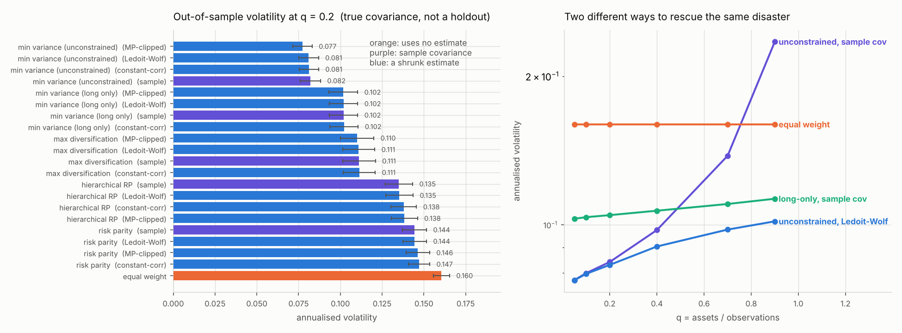
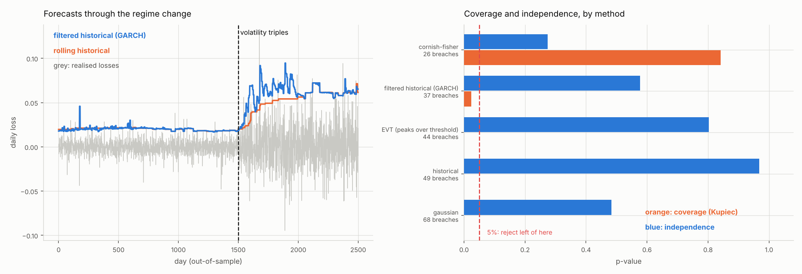

# `portlab` — portfolio construction and risk, measured against a known truth

Two questions, both of which have a definite answer that is rarely measured:

1. **Does using an estimated covariance matrix beat not using one?** Not
   always. A minimum-variance portfolio built on a sample covariance matrix
   goes from an annualised 7.7% volatility to **23.5%** — worse than equal
   weights — as the ratio of assets to observations rises from 0.05 to 0.9.
   Two completely different fixes rescue it, and which one wins depends on
   that ratio.

2. **Was your value-at-risk model ever a risk model?** Through a regime
   change, a rolling historical VaR breaches at 1.3% while things are quiet
   and **3.0%** once volatility triples. It does adapt — over the length of
   its window, not the length of the shock. And the method that scores best
   on the aggregate coverage test is one that is wrong in *both* regimes, in
   directions that cancel.

Everything here is validated on synthetic markets whose covariance is known
*exactly*, so out-of-sample risk is computed in closed form rather than
estimated from a holdout. On historical data the out-of-sample covariance is
itself an estimate, so a horse race partly measures which estimator happens to
resemble the test period's sample covariance.

```bash
pip install -e ".[dev,plot]" && pytest tests/ -q
```

66 tests, 97% coverage.

---

## 1. Why the sample covariance matrix cannot be handed to an optimiser

With `N` assets and `T` observations there are `N(N+1)/2` parameters to
estimate, and the ratio `q = N/T` controls everything. The Marchenko–Pastur
law says that when the *true* covariance is the identity, the sample
eigenvalues still spread over `[(1−√q)², (1+√q)²]`. At `q = 0.5` the smallest
sample eigenvalue is about **0.086** against a true value of 1.

An optimiser inverts that matrix, so its largest bets go precisely on the
smallest eigenvalues — the ones that are most badly estimated. It sees a
risk-free direction that does not exist.

Three estimators, in increasing order of structure assumed:

- **Ledoit–Wolf** shrinks towards a scaled identity with the intensity
  *derived*, not tuned. Shrink in proportion to how noisy the sample matrix is
  relative to how much structure the target would discard — both estimable
  from the same sample, which is why no cross-validation is needed.
- **Constant-correlation shrinkage** uses a better target for equities: every
  pairwise correlation set to the average. The identity target throws away the
  single most important feature of an equity covariance matrix — that
  everything moves together.
- **Marchenko–Pastur clipping** replaces every eigenvalue inside the noise
  bulk with their average. An eigenvalue inside the bulk is statistically
  indistinguishable from what pure noise produces, so its eigenvector carries
  nothing worth keeping; eigenvalues above the upper edge are real structure
  and are left alone.

The empirical spectrum follows the theory to within 5% across the interior of
the bulk, which the test suite checks directly — if it did not, the estimator
would be wrong before any portfolio was built on it.

## 2. The horse race



Annualised out-of-sample volatility, computed exactly from the true
covariance, 100 assets, averaged over draws:

| q = N/T | unconstrained, sample | unconstrained, Ledoit–Wolf | long-only, sample | equal weight |
|---|---|---|---|---|
| 0.05 | 0.077 | 0.077 | 0.103 | 0.160 |
| 0.20 | 0.084 | 0.083 | 0.105 | 0.160 |
| 0.40 | 0.098 | 0.090 | 0.107 | 0.160 |
| 0.70 | 0.138 | 0.098 | 0.110 | 0.160 |
| 0.90 | **0.235** | **0.102** | 0.113 | 0.160 |

The first version of this experiment ran minimum variance **long-only only**,
and produced a surprising result: the sample covariance was as good as any
shrinkage estimator at every `q`. That is a real effect, not a bug, and a
known one — a no-short-sale constraint is *itself* a form of shrinkage
(Jagannathan and Ma), because binding non-negativity constraints act exactly
like reducing the largest covariance entries. With the constraint in place
there is almost nothing left for an estimator to improve.

Running the unconstrained problem alongside makes it visible. There the sample
covariance fails in the textbook way, and the two rescues can be compared on
equal terms: **shrink the estimate, or constrain the weights**. Both work.
Shrinkage wins at high `q` (0.102 against 0.113 at `q = 0.9`); the constraint
costs more at low `q`, where there is enough data that the extra freedom is
worth having.

**Reproduce:** `python experiments/horse_race.py`

## 3. Value at risk, and whether it survives contact with a regime change



A 99% VaR is a falsifiable claim: losses exceed it on 1% of days, and the
breaches do not cluster. Five methods are run as rolling one-step-ahead
forecasts — the model sees only the preceding window — through a market with a
volatility level shift, autocorrelated volatility within each regime, and
Student-t innovations. Each feature defeats a different method.

That the forecasts are rolling matters more than it sounds. Fitting a GARCH
model on the whole sample and then "backtesting" it uses the stressed period
to calibrate the forecast for the stressed period, which is how filtered
historical simulation gets reported as near-perfect.

Breach rates, split at the switch (25 breaches expected over 2,500 days):

| method | breaches | quiet | stressed | Kupiec p | Basel |
|---|---|---|---|---|---|
| Cornish–Fisher | 26 | 0.6% | 1.7% | 0.84 | green |
| filtered historical (GARCH) | 37 | 1.2% | 1.9% | 0.024 | amber |
| EVT (peaks over threshold) | 44 | 1.1% | 2.8% | 0.0006 | amber |
| rolling historical | 49 | 1.3% | 3.0% | <0.0001 | red |
| Gaussian | 68 | 1.5% | 4.5% | <0.0001 | red |

**Two things here were not what I expected.**

First, I assumed *independence* would be the discriminating test — that the
static methods would keep roughly the right breach count overall and fail on
clustering. They do not. With a rolling window every method passes
independence comfortably, because the window eventually rolls into the
stressed period and the breaches spread out. They fail on **coverage**
instead, and the per-regime split shows why: a rolling historical VaR adapts
over the length of its *window*, not the length of the shock. A risk number
that becomes correct two years after the regime changed is not a risk number.

Second, **Cornish–Fisher wins on aggregate coverage, and should not be
trusted for it.** Look at the per-regime columns: it breaches at 0.6% when
quiet and 1.7% under stress — a swing of 2.8×, wrong in both regimes in
opposite directions, which happens to cancel in the total. The GARCH filter
swings by 1.6×, the least of any method, and is penalised on the aggregate
test for being consistently slightly loose rather than alternately far too
tight and far too loose.

The mechanism is worth naming: when the rolling window straddles the switch it
contains both quiet and stressed days, so its sample kurtosis spikes, and
Cornish–Fisher inflates its quantile in response. It adapts through the
kurtosis channel by accident. That is not a robust property — the same
over-reaction is what makes it return a 6.2% VaR on genuinely fat-tailed data
where the honest answer is 2.7%.

This is the same lesson as §5 in a different guise: an aggregate test can be
passed by a model that is wrong everywhere, as long as it is wrong in
offsetting directions. Reporting the breach rate per regime costs nothing and
is what actually distinguishes the methods.

**Reproduce:** `python experiments/var_backtest.py`

## 4. A structural break makes GARCH look permanent

A single GARCH process cannot express a permanent change in volatility level,
so the only way it can fit one is by making every shock nearly permanent.
Fitted on the regime-change series, persistence goes to the stationarity cap —
a shock half-life of 6,900 days and an implied unconditional volatility of
**122% annualised**, against a truth of 12% rising to 38%. Fitted on clean
GARCH data the same code returns persistence 0.959 and a half-life of 16 days.

This is the Lamoureux–Lastrapes effect, and the practical consequence is
narrow but worth knowing: the unconditional variance and long-horizon
forecasts become meaningless, while the one-step-ahead forecast — the only
thing a daily VaR needs — stays accurate, because it is driven by the
recursion rather than by the mean-reversion target.

## 5. Why both VaR backtests are needed

Twenty consecutive breaches in two thousand days is *exactly* the expected
count at 99%. Kupiec's proportion-of-failures test sees nothing at all —
`p = 1.000` — because its statistic depends only on the total, so any
reordering gives the same answer. Christoffersen's independence test rejects
at a likelihood ratio of **199**.

A firm relying on the first test alone would discover its risk system does not
work during exactly the fortnight it needed it to.

## Layout

```
src/portlab/
  covariance.py     sample, Ledoit-Wolf, constant-correlation, MP clipping
  optimizers.py     min variance, risk parity, HRP, max diversification, BL
  risk.py           VaR and ES five ways, including GARCH and EVT tails
  backtest_var.py   Kupiec, Christoffersen, Basel traffic light
  market.py         factor markets with known covariance; a regime change
tests/              66 tests, 97% coverage
experiments/        the two figures above, reproducible end to end
```

## On the numerics

The two allocators that need a numerical method use algorithms whose
convergence is a property rather than a hope, so neither needs a
general-purpose solver, a starting guess, or a tolerance tuned per problem:

- **Long-only minimum variance** is accelerated projected gradient with an
  *exact* Euclidean projection onto the simplex (the sort-based algorithm of
  Duchi et al., `O(n log n)`, no iteration). The step size is `1/L` with `L`
  the largest eigenvalue, which is the Lipschitz constant of the gradient, so
  convergence is `O(1/k²)` with no line search.
- **Risk parity** is cyclical coordinate descent on
  `f(x) = ½x'Σx − Σ bᵢ log xᵢ`. Fixing all but one coordinate reduces the
  first-order condition to a scalar quadratic with exactly one positive root,
  so each update is a closed-form square root. The log barrier keeps every
  weight strictly positive, so no weight can go negative and no projection is
  needed. Risk contributions come out equal to `1e-10`.

Risk contributions and component VaR both use Euler's theorem, which is exact
rather than an accounting convention: portfolio volatility is homogeneous of
degree one in the weights, so the parts sum to the whole — checked to `1e-12`.

## License

MIT
